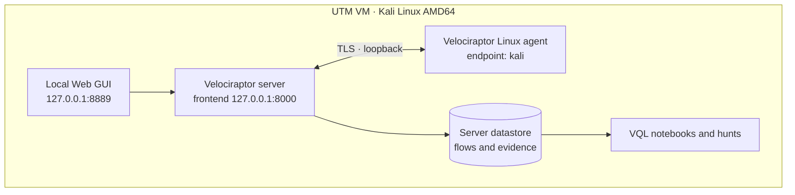
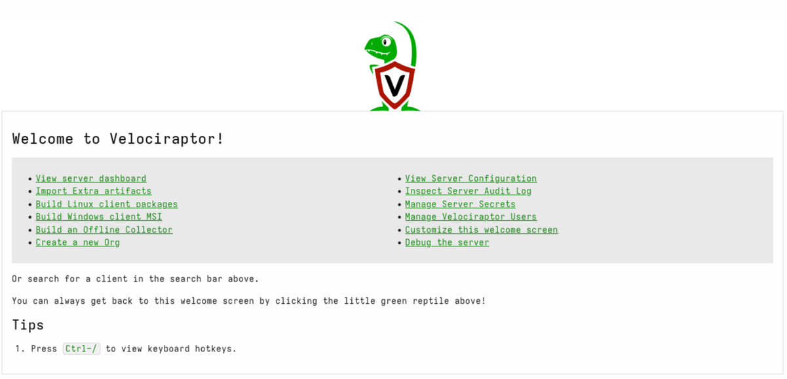
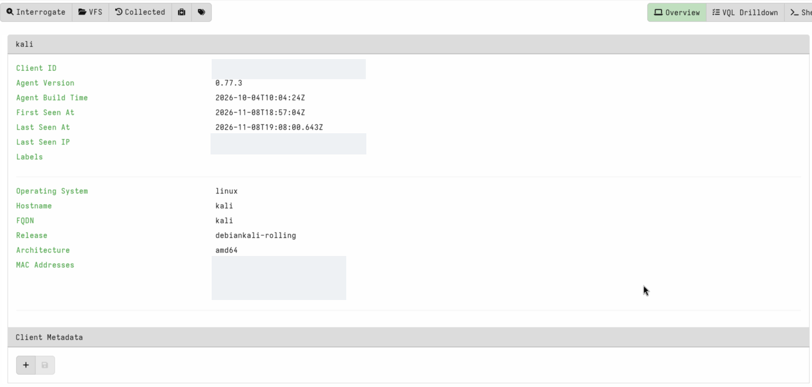
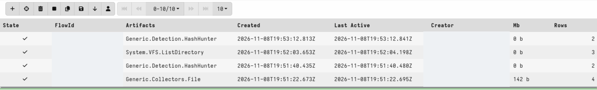
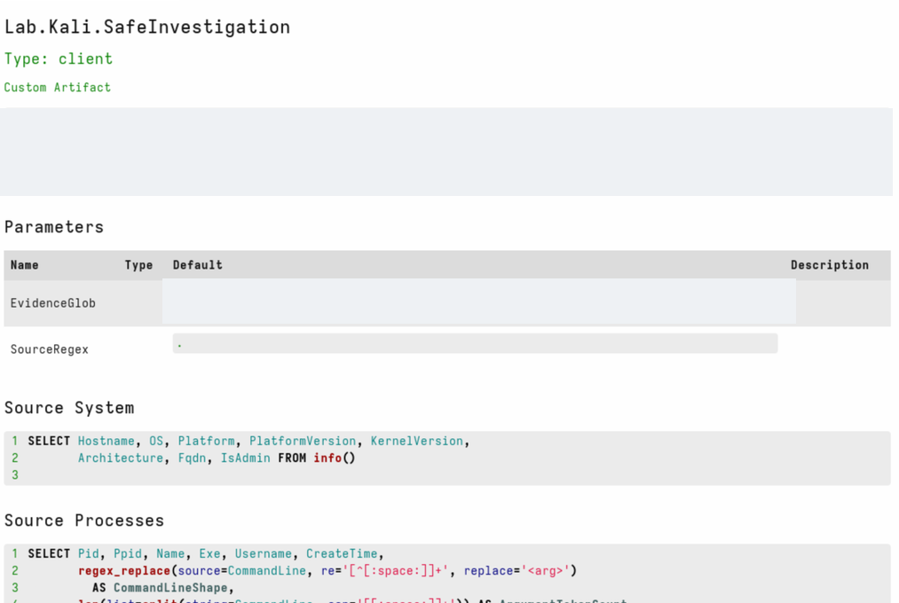
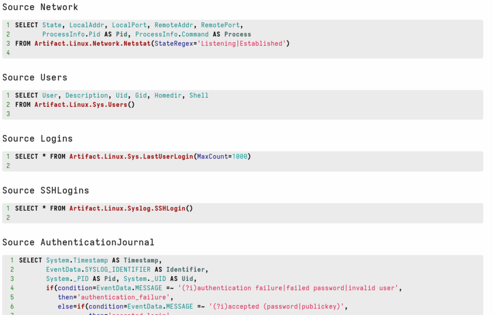
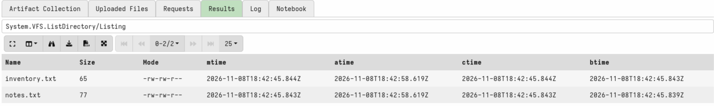
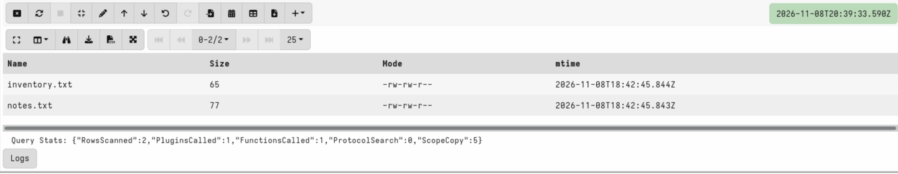

# Velociraptor DFIR Lab on Kali Linux

**Endpoint visibility · Forensic artifact collection · VQL investigation · Threat hunting**

A reproducible, single-endpoint **Digital Forensics and Incident Response (DFIR)** laboratory built with [Velociraptor](https://docs.velociraptor.app/) 0.77.3 and Kali Linux running in UTM. This project documents the deployment, collected evidence, controlled hash hunting, and notebook-based analysis of saved results. The investigation uses **authorized, synthetic test files**; it does not claim a real compromise.

**Environment:** Kali Linux Rolling 2026.3 · Linux AMD64 · UTM · Velociraptor 0.77.3 · localhost-only deployment

**Maintainer:** [@heppenedbefore](https://github.com/heppenedbefore)

## At a glance

| Evidence-backed outcome | Observation |
| --- | --- |
| Server + agent | Active Linux services; local client visible as connected |
| Artifact collections | **6** completed server-side collection flows |
| Endpoint investigation | **219** processes and **17** TCP entries from separate **local VQL queries** |
| Account and sign-in artifacts | **59** local user records; **41** login-history records |
| Authentication-journal review | **271** locally classified events |
| Controlled hunt | **2** expected matches against known benign sample-file hashes, **one** client |
| Investigation notebook | **2** saved file records retrieved through the VFS `Listing` source |
| Custom artifact | Visible in GUI catalog; **no separate complete collection flow verified** |

> **Evidence scope:** The completed flows, local CLI queries, and controlled hunt are different types of evidence. Counts are intentionally attributed to their actual collection method. No malicious activity is inferred solely from the observations.

## Architecture



**Why this architecture?** The server, browser, and agent run inside the same isolated Kali guest. This validates the end-to-end DFIR workflow without exposing a management interface to a wider network. It is **not** a multi-host or production deployment.

## Visual walkthrough

### 1 · Local administration console



The local Web UI presents client search, artifact management, hunt orchestration, and investigation notebooks.

### 2 · Enrolled Linux endpoint



The local endpoint is online and identifies as a Linux AMD64 client running Velociraptor 0.77.3. Endpoint-specific identifiers and MAC addresses are permanently redacted.

### 3 · Artifact collection results



A section of the collection history shows completed file acquisition, VFS directory listing, and hash-hunting flows. Internal collection identifiers and the service-account name are redacted.

### 4 · Custom forensic artifact



`Lab.Kali.SafeInvestigation` is present in the GUI artifact catalog. This **demonstrates registration, not a verified completed run** of every source.

### 5 · VQL-driven investigation design



The artifact defines data sources for network sockets, user accounts, and login history. A definition is not, by itself, evidence that a collection finished.

### 6 · Filesystem evidence



The VFS `Listing` source returned **two** demonstration files: `inventory.txt` (65 bytes) and `notes.txt` (77 bytes).

### 7 · Read stored results in a notebook



A global investigation notebook queried a *previously completed* flow. `RowsScanned = 2` confirms two stored result rows were retrieved without re-collecting the endpoint.

## Investigation workflow

1. **Prepare** an isolated Kali VM and obtain the official Velociraptor AMD64 release.
2. **Validate** the downloaded release and configure the local server and Linux agent.
3. **Start and verify** services, confirm GUI access and online agent status.
4. **Collect** system inventory, user accounts, login history, SSH log data, sample-file content, and a VFS directory listing.
5. **Investigate locally** process activity, listening/established TCP sockets, and selected authentication journal events.
6. **Validate integrity** with SHA-256 digests of two controlled test files.
7. **Hunt** for those known sample-file hashes on a single explicitly scoped Kali endpoint.
8. **Analyze** stored VFS results in a notebook; resolve empty queries by selecting `source="Listing"`.
9. **Document** results, limitations, and reproducibility boundaries.

## Reproducible VQL example

The global-notebook read below is a **template**; replace the two placeholder IDs with actual values from *your own* client and its completed collection.

```sql
SELECT Name, Size, Mode, mtime
FROM flow_results(
  client_id="C.REPLACE_WITH_YOUR_CLIENT_ID",
  flow_id="F.REPLACE_WITH_YOUR_FLOW_ID",
  artifact="System.VFS.ListDirectory",
  source="Listing"
)
LIMIT 10
```

The `source` argument matters: the `System.VFS.ListDirectory` artifact emitted separate `Listing` and `Stats` sources. Omitting `Listing` was the reason an earlier notebook query returned zero rows.

Browse [all documented query examples](queries/) and [the notebook explanation](docs/vql-notebooks.md).

## Documentation

| Guide | Contents |
| --- | --- |
| [Architecture](docs/architecture.md) | Components, trust boundaries, ports and topology |
| [Deployment](docs/deployment.md) | Installation sequence and verification workflow |
| [Investigation methodology](docs/methodology.md) | Scope, collection method and evidence handling |
| [Forensic investigations](docs/investigations.md) | Process, network, accounts, files and SHA-256 |
| [Threat hunting](docs/threat-hunting.md) | Controlled single-client hunt and interpretation |
| [VQL notebooks](docs/vql-notebooks.md) | Read saved results and avoid source-selection errors |
| [Results and limitations](docs/results.md) | Verified metrics and what remains unproven |
| [Troubleshooting](docs/troubleshooting.md) | Service access, permissions, source selection, reboot recovery |

`examples/` contains sanitized result summaries only; raw logs, private configuration, credentials, full datastores, and virtual machine images are excluded.


## Limitations

- A **single** Kali endpoint was tested, not a fleet of endpoints.
- Hash-hunt matches are intentionally planted benign examples, **not confirmed malware**.
- A custom artifact was registered; independent execution of all its sources was **not** established.
- Local process/network/journal interrogations are **not** the same as the six remote server flows.
- The results represent an observed laboratory state; they are not a general security assessment of Kali or macOS.

## Responsible use & references

Only deploy monitoring and collect data from devices you own or are explicitly authorized to investigate. Treat endpoint data as sensitive and limit retention to investigative needs.

- [Official Velociraptor documentation](https://docs.velociraptor.app/docs/)
- [Deployment quickstart](https://docs.velociraptor.app/docs/deployment/quickstart/)
- [Velociraptor hunting guide](https://docs.velociraptor.app/docs/hunting/)
- [VQL `flow_results()` reference](https://docs.velociraptor.app/vql_reference/server/flow_results/)
- [Velociraptor release 0.77.3](https://github.com/Velocidex/velociraptor/releases/tag/v0.77.3)

**Licensing note:** This repository does not claim ownership of Velociraptor or its third-party components. The maintainer should select a license for the original documentation and scripts before soliciting contributions.
